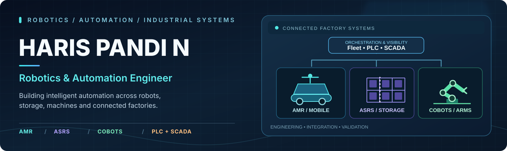
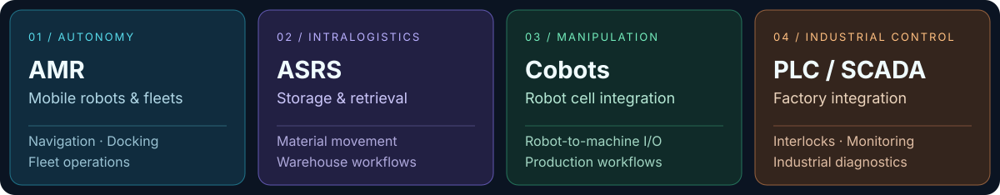
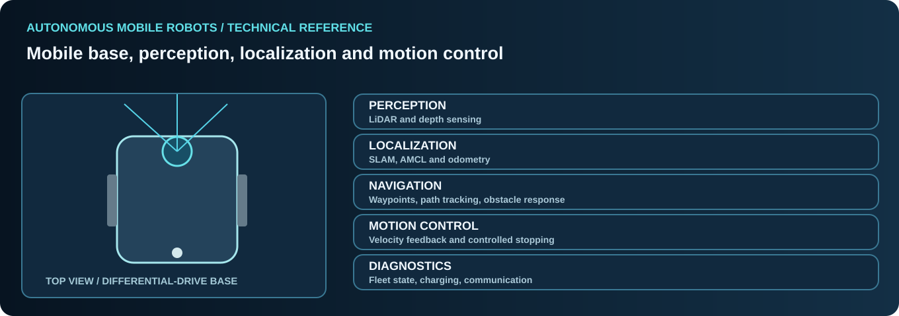
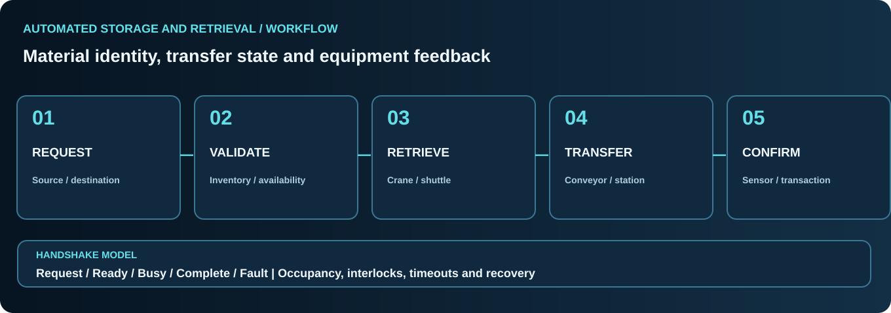
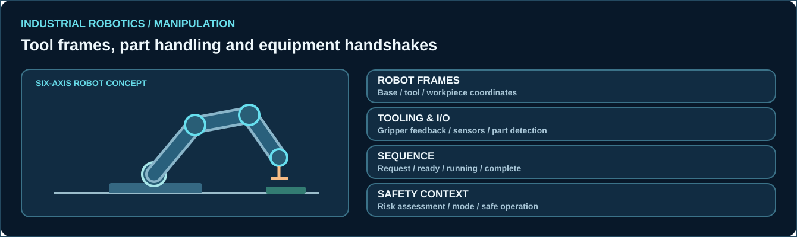
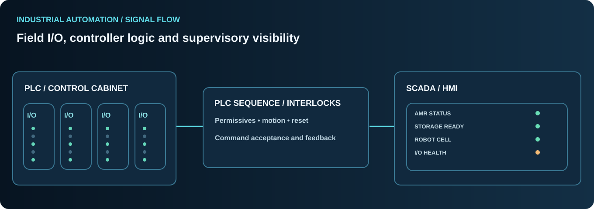
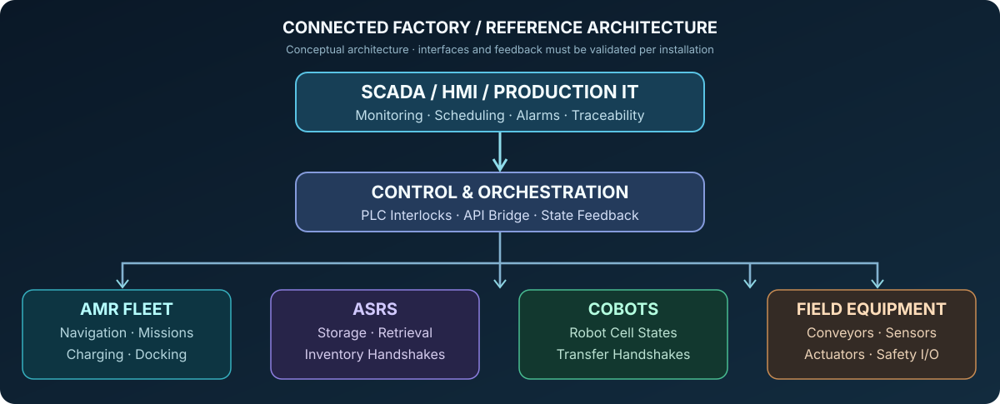
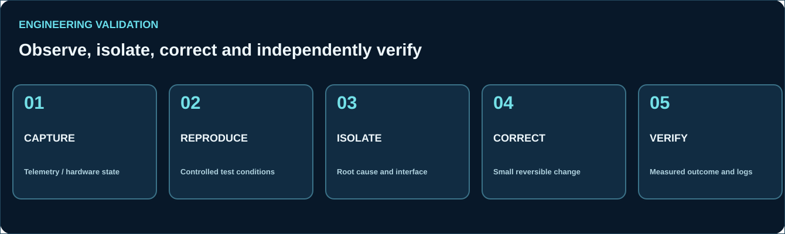

**ROBOTICS SOFTWARE • AUTONOMOUS MOBILE ROBOTS • INDUSTRIAL AUTOMATION • SYSTEM INTEGRATION**

[Engineering domains](#engineering-domains) · [Technical expertise](#technical-expertise) · [System architecture](#integrated-systems) · [Knowledge library](#engineering-knowledge-library) · [Connect](#connect)

## Engineering profile

I'm **Hareespandy N**, a **Robotics & Automation Engineer** with a background spanning autonomous mobile robotics, industrial robot systems, PLC/SCADA, automated material handling and software-based equipment integration.

My engineering knowledge connects **robot motion, sensor feedback, control logic, communications and operator-facing software**. I work with C++/Python, ROS 2/Nav2 concepts, PLC interfaces, API services, industrial networking, robot commissioning and diagnostic tools.

I value systems that are technically explainable: every movement should have a command and measurable feedback; every machine sequence should have clear prerequisites and completion signals; every unexpected failure should provide useful diagnostics.

## Engineering domains

### Real industrial equipment references

<table>
<tr>
<td width="50%" align="center"> <strong>Autonomous Mobile Robotics</strong></td>
<td width="50%" align="center"> <strong>Automated Storage & Retrieval</strong></td>
</tr>
<tr>
<td colspan="2" align="center"> <strong>Industrial Robot Cells & Collaborative Automation</strong></td>
</tr>
</table>

Photographs are independent industrial references, not personal deployment evidence. Photographer attribution and licenses are documented in [Image Credits](IMAGE_CREDITS.md). The technical drawings below are original conceptual illustrations.

## Autonomous mobile robotics

**Core capabilities and knowledge:**
- Differential-drive kinematics, wheel odometry, velocity profiles and controlled stopping.
- LiDAR-based mapping, SLAM concepts, AMCL and pose estimation.
- ROS 2 and Nav2 navigation architecture, goals, waypoints and robot coordinate frames.
- Local obstacle response, route constraints, robot footprint and narrow-path considerations.
- RGB-D perception, sensor connectivity and industrial interface diagnostics.
- Fleet monitoring, mission feedback, docking/charging states and alarm classification.

The focus is on understanding **requested motion versus observed behavior**, not presenting a software target as guaranteed physical accuracy.

[Detailed AMR engineering reference →](knowledge/AMR_AUTONOMY.md)

## ASRS and material-handling automation

Storage and retrieval automation requires more than a rack and a transfer command. Inventory identity, occupancy, crane or shuttle position, transfer-station availability and verified receiver readiness must agree before a material movement can progress.

**Areas of knowledge:** ASRS systems, conveyor transfers, pallet and bin movement, retrieval workflows, buffering, PLC handshakes, status monitoring, timeout handling and recovery.

[Material-flow and intralogistics reference →](knowledge/ASRS_MATERIAL_FLOW.md)

## Industrial robots and collaborative systems

My industrial automation background includes robotic cell setup, programming and troubleshooting across established industrial robot environments.

**Technical scope:**
- Joint and Cartesian motion, robot frames and tool center point concepts.
- Pick-and-place, material transfer, feeder and conveyor integration.
- End-effectors, gripping feedback, workpiece position and machine I/O.
- Robot-to-PLC sequencing, ready/busy/complete feedback and recoverable faults.
- Collaborative application considerations, workspace layout and risk assessment.

**Robotic platforms encountered:** ABB, FANUC, KUKA and Yaskawa.

[Industrial robot and cobot engineering reference →](knowledge/ROBOT_CELLS.md)

## PLC, SCADA and industrial control

A sound automation design separates the **field layer**, **controller layer** and **operator/supervisory layer** while preserving feedback across each boundary.

- PLC sequencing, permissives, field I/O, interlock conditions and fault recovery.
- Servo and motion-control integration.
- HMI and SCADA visualization, alarm handling and operational monitoring.
- Machine-to-robot and conveyor coordination.
- Communication analysis involving TCP/IP, CAN and RS-485.
- Device health, control-system diagnostics and commissioning procedures.

**PLC ecosystems represented in my technical background:** Siemens, Rockwell/Allen-Bradley, Mitsubishi and Schneider.

[PLC and SCADA technical reference →](knowledge/PLC_SCADA.md)

## Integrated systems

Reliable automation exists across layers rather than inside a single robot or PLC program.

| Layer | Responsibilities | Engineering concern |
| :-- | :-- | :-- |
| Applications | Operator UI, monitoring, records, workflow input | User intent, status freshness, traceability |
| Orchestration | Tasks, fleet coordination, state transitions | Prerequisites, fault classification, recovery |
| Controllers | PLC, robot controller, motion interfaces | Command ownership and accepted states |
| Field equipment | Sensors, actuators, robots, conveyors, drives | Physical feedback and device health |
| Verification | Diagnostics, logging, commissioning | Independently measured behavior |

## Technical expertise

| Area | Tools, languages and concepts |
| :-- | :-- |
| Programming | **C++, C, Python, SQL, Bash, PowerShell** |
| Robotics | **ROS 2, Nav2, SLAM, AMCL, LiDAR, odometry, navigation** |
| Applications | **FastAPI, REST APIs, WebSocket, PyQt6** |
| Industrial controls | **PLC, SCADA, HMI, servo/motion systems, I/O and interlocks** |
| Connectivity | **TCP/IP, CAN, RS-485, equipment-level communication** |
| Development | **Ubuntu/Linux, Windows, Git, Docker** |
| Industrial processes | **Robot cells, conveyors, ASRS, machine sequencing, material handling** |
| Engineering practice | **Commissioning, diagnostics, fault isolation, measured verification** |

## Software and integration engineering

Knowledge spanning robotics middleware, controller-facing interfaces, diagnostic tooling and operator applications.

- Clear separation between **request accepted**, **action running** and **physical completion confirmed**.
- APIs that preserve backend errors rather than hide precondition failures.
- Telemetry with meaningful timestamps, robot identity and connection state.
- Linux and Windows-based engineering workflows.
- Maintainable scripts, structured results and traceable system behavior.

[Robotics software and API knowledge →](knowledge/SOFTWARE_INTEGRATION.md)

## Engineering method

**Observe → Reproduce → Isolate → Correct → Verify**

I approach system problems by identifying whether the cause is software, networking, sensing, control I/O, drivetrain or operating state. A change is only credible when its result is supported by an appropriate measurement or reproducible test.

[Commissioning and diagnostics reference →](knowledge/COMMISSIONING.md)

## Engineering knowledge library

Six detailed technical references organize the knowledge behind this profile.

| Knowledge area | Technical reading |
| :-- | :-- |
| Autonomous systems | [AMR motion, localization, sensing and fleet operation](knowledge/AMR_AUTONOMY.md) |
| Storage automation | [ASRS and intralogistics transfer architecture](knowledge/ASRS_MATERIAL_FLOW.md) |
| Robotic manipulation | [Industrial robots, cobots, tooling and I/O](knowledge/ROBOT_CELLS.md) |
| Industrial control | [PLC, SCADA, monitoring and equipment feedback](knowledge/PLC_SCADA.md) |
| Robotics software | [C++/Python, ROS 2, APIs and integration](knowledge/SOFTWARE_INTEGRATION.md) |
| Engineering quality | [Commissioning, diagnostics and verification](knowledge/COMMISSIONING.md) |

## Professional background and direction

**Education:** B.E. in Robotics & Automation (Mechatronics).

**Engineering focus:** Industrial robotics, autonomous systems, factory software, controls engineering, warehouse automation and connected equipment.

**International perspective:** Based in South Korea and open to international engineering opportunities.

## Connect

[**LinkedIn**](https://www.linkedin.com/in/Hareespandy) · [**GitHub**](https://github.com/Hareespandy-N)

---

Public content describes transferable engineering knowledge and areas of experience. No employer names, customer names, identifying work projects, private source code, operational data, or unverified performance statistics are presented.
