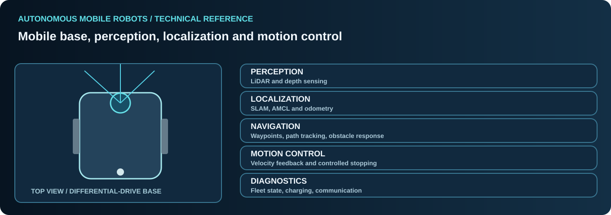

# Autonomous Mobile Robotics

[← Professional profile](../README.md)

## Autonomous mobile robot fundamentals

An AMR is a complete control system whose navigation depends on sensing, localization, robot kinematics, environment geometry and a reliable interface between the software planner and the physical drivetrain.

### Differential-drive motion
- Forward velocity and angular velocity are translated into independent left/right wheel velocities.
- Wheel diameter, wheelbase, wheel slip, gear ratios and caster behavior affect actual motion.
- Odometry is useful feedback, but accumulated drift makes it unsuitable as the sole independent proof of absolute positioning.
- Acceleration, deceleration, yaw correction and stopping criteria must be evaluated together.
- Payload changes and floor condition can affect position repeatability.

### Mapping and localization
- LiDAR-based 2D environment representation, SLAM concepts and map quality.
- AMCL and probabilistic pose estimation using a map, laser observations and odometry.
- Localization jumps, reflective surfaces, scan occlusions and repetitive factory geometry.
- Sensor-to-base transforms, timestamp consistency and pose-frame conventions.
- QR/marker-based position correction and auxiliary sensor references where applicable.

### Navigation architecture
- Mission goals, waypoint selection, route following and goal acceptance.
- Local costmaps, robot footprint and clearance constraints.
- Obstacle detection versus navigation slowdown, blocked-path handling and resumption.
- Narrow passage behavior and controlled approach to stations.
- Separating completion of robot motion from external machine/task completion.

### Hardware and industrial interfaces
- Laser scanners, RGB-D sensors, odometry, encoders, motor drives and industrial digital I/O.
- CAN and RS-485 diagnostics, connection health and stale-feedback handling.
- Docking and charging station interactions using feedback from both sides.
- Battery state, charging feedback and robot availability indicators.

### Verification and diagnostics

| Area | Evidence worth collecting |
|---|---|
| Localization | Estimated pose, covariances, scan alignment and timestamp |
| Motion | Commanded velocity, wheel/odometry feedback and physical movement |
| Position accuracy | External measurement, repeated runs and payload conditions |
| Obstacle response | Detection, commanded response, protective system state |
| Station handling | Arrival tolerance, machine feedback and recovery state |
| System health | CPU load, communication status, controller errors and logs |

Reliable motion tuning means distinguishing target values from measured outcomes. Safety-rated protective functions are separate from application navigation and must remain correctly implemented.

*General engineering knowledge. No customer maps, coordinates, code or deployment details.*
