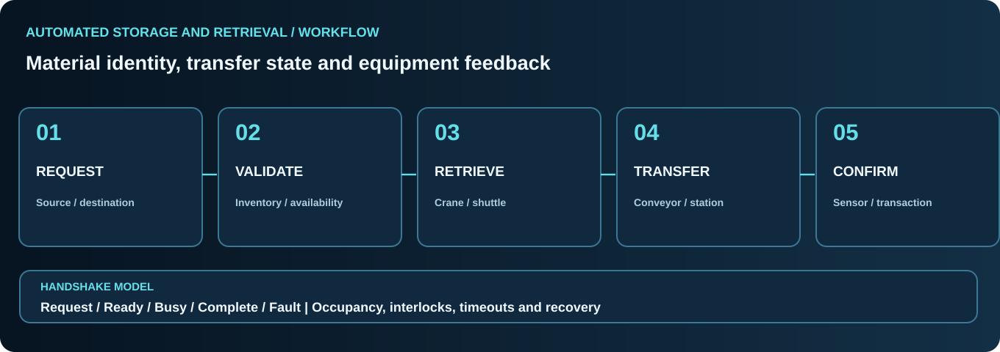

# ASRS, Conveyors & Intralogistics

[← Professional profile](../README.md)

## Automated storage and retrieval

ASRS equipment coordinates inventory locations, storage movement and controlled transfer points. Reliable operation depends on the identity of a storage unit, the intended destination and verified mechanical feedback.

### Main functional elements
- Aisles, racks, addressable storage locations and occupancy.
- Stacker crane, shuttle and vertical lift concepts.
- Pallet, tote, bin and carrier interfaces.
- Conveyor zones and buffering between machines.
- Transfer stations connecting storage, mobile robots and production equipment.

### Material-flow state machine

| State | System responsibility | Confirmation |
|---|---|---|
| Request | Identify source, destination and load | Order validity |
| Validate | Check inventory, occupancy and station readiness | Equipment permissives |
| Execute | Move or retrieve a storage unit | Movement feedback |
| Transfer | Coordinate sender and receiver | Presence and handshake |
| Complete | Confirm load transfer and inventory update | Both systems agree |
| Fault | Stop progression on mismatch or timeout | Alarm and recovery procedure |

### Integration with industrial controls

PLC handshake logic must reflect physical equipment state, not just messages acknowledged by software. Conveyor-ready, station-occupied, crane-at-position, transfer-complete and fault conditions are separate signals.

Useful diagnostic cases include unavailable racks, mismatched load presence, stale signals, transfer timeout, duplicate requests and restart during an unfinished move.

### Performance concepts
- Throughput and cycle-time components
- Buffer sizing and congestion
- Travel and transfer sequence optimization
- Traceability and alarm/event history
- Mechanical cycle constraints and system availability

*This is a knowledge overview of ASRS architecture and integration, not a claim about a particular deployed facility.*
