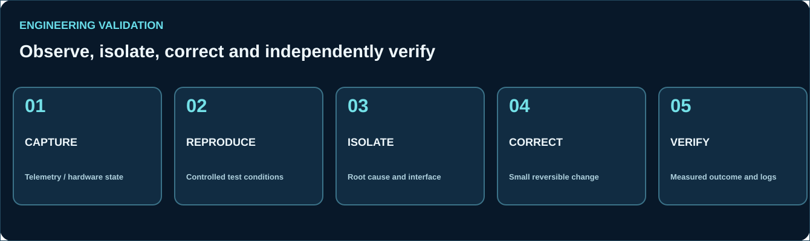

# Commissioning and Engineering Diagnostics

[Return to professional profile](../README.md)

## Engineering workflow

A reliable integration needs repeatable observations and measurable verification, not only a successful software status.

1. **Observe:** read physical status, controller feedback, logs and timestamps.
2. **Isolate:** separate hardware, network, sensing, motion and application problems.
3. **Reproduce:** establish repeatable, approved test conditions.
4. **Correct:** change the smallest relevant component while preserving rollback information.
5. **Verify:** confirm both software behavior and the real equipment result.
6. **Document:** record what changed, why it changed, what was measured and what remains uncertain.

## Technical diagnostic areas

| Domain | Diagnostic evidence |
| --- | --- |
| Robot localization | Map and odometry inputs, estimated pose, scan correspondence |
| Robot motion | Requested velocity, drive feedback and independent position measurement |
| Navigation | Goal state, costmap conditions, obstacle feedback and task result |
| Machine I/O | Requested command, permissives, physical feedback, alarm |
| SCADA/HMI | Time-stamped equipment states, trends, fault context |
| Network services | Reachability, protocol response and data freshness |
| System performance | CPU, memory, process health and log analysis |

## Integration quality

- Distinguish commands issued, accepted and physically completed.
- Preserve diagnostic error information instead of hiding it.
- Measure performance claims with defined test conditions.
- Treat safety-rated functionality as an independent engineering requirement.
- Keep public technical materials separate from proprietary customer implementations.

This document describes transferable skills and working principles, not specific employers, customers or proprietary projects.
