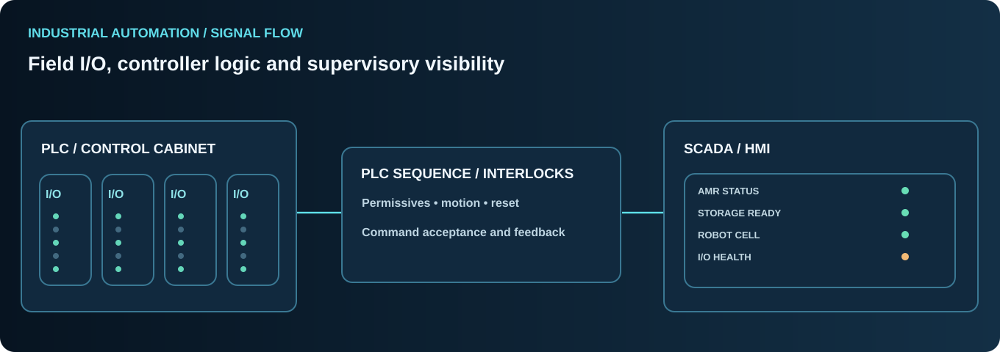

# PLC, SCADA, HMI & Motion-Control Systems

[← Professional profile](../README.md)

## Industrial controls engineering

Industrial automation depends on the relationship between field signals, controllers, actuators and operators. An effective control design communicates not just what should happen but what the physical machine has confirmed.

### PLC engineering knowledge
- Digital and analog I/O configuration, signal mapping and diagnostics.
- Sequential logic, interlocks, permissives, timer conditions and fault recovery.
- Conveyor control, feeder integration and machine-to-robot handshakes.
- Servo drive status, motion-controller feedback and sequence synchronization.
- Electrical control-panel commissioning and troubleshooting.
- Differences between command bits, running state, feedback and completion.

### Control ecosystems

Professional familiarity with **Siemens, Rockwell / Allen-Bradley, Mitsubishi and Schneider** PLC environments and industrial control conventions.

### SCADA and HMI
- Equipment monitoring, event history and alarms.
- HMI screens representing clear machine states and operator actions.
- Data acquisition, equipment health and troubleshooting aids.
- Historical and live values, telemetry freshness and communication state.
- Alarm categorization and meaningful recovery guidance.

### Communication and instrumentation
- TCP/IP and Ethernet-based industrial networking.
- CAN and RS-485 hardware/protocol troubleshooting.
- REST/WebSocket software integration at higher system layers.
- Presence sensors, position feedback and I/O readback.

### Interface design principles

| Event | Control meaning | Operator interpretation |
|---|---|---|
| Command requested | Intention submitted | Pending |
| Request accepted | Preconditions evaluated | Accepted, not yet complete |
| Equipment busy | Physical sequence underway | Running |
| Completion feedback | End condition confirmed | Completed |
| Interlock fault | Action inhibited | Blocked with reason |
| Communication timeout | State may be unknown | Stale / unavailable |

Software status cannot substitute for appropriate certified safety controls.

*Generalized technical knowledge, not customer-specific ladder logic or wiring.*
