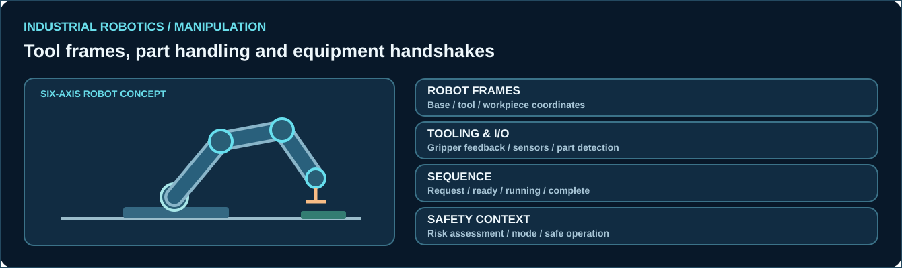

# Industrial Robots, Cobots & Workcells

[← Professional profile](../README.md)

## Robotic manipulation

Industrial robot integration combines programmed motion, tool center points, workpiece geometry and machine I/O into a coherent process sequence. Experience with industrial robot programming and troubleshooting provides a basis for evaluating both traditional and collaborative robot applications.

### Robot programming concepts
- Joint-space and Cartesian movement
- Base frame, work frame and tool center point
- Approach, pick, process, place and retract sequence design
- Robot payload, work envelope and reachability
- Position offsets and part alignment
- Motion speed, blending and cycle-time reasoning

### Tools and external equipment
- Pneumatic grippers, vacuum tools and end-effectors
- Tool-ready and part-present sensing
- Conveyors and feeders, palletizing and machine loading
- Robot/controller digital I/O and PLC handshake
- Cell operating modes, alarm acknowledgement and recovery

### Industrial robot platforms

Knowledge and practical exposure include **ABB, FANUC, KUKA and Yaskawa** industrial robot environments, as documented in my professional background.

### Collaborative robot applications

Collaborative operation requires careful consideration of tooling, accessible space, intended human interaction and risk assessment. It is not enough for a robot to be marketed as a cobot: application-specific protective measures and validated operating conditions matter.

### Commissioning and troubleshooting
1. Confirm the robot and mechanical tooling configuration.
2. Verify reference frames, part coordinates and movement boundaries.
3. Validate the signal sequence with surrounding equipment.
4. Observe I/O feedback and position confirmation.
5. Reproduce and classify alarms before changing parameters.
6. Test recovery from an interrupted or incomplete cycle.

*Technical knowledge and professional skills, without naming companies, customers or work projects.*
