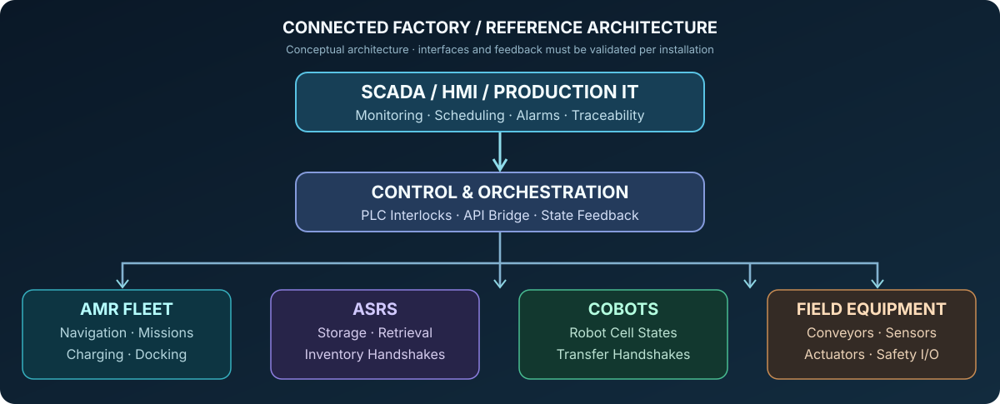

# Robotics Software & Integration

[Return to professional profile](../README.md)

## Core software skills

**C++ and C:** robot-side computation, control interfaces and performance-conscious programming.

**Python:** robotics applications, diagnostic scripts, integration services and engineering automation.

**SQL, Bash, PowerShell:** operational data, system administration and repeatable troubleshooting tools.

**Linux, Windows, Git and Docker:** robotic computing, development and service lifecycle tools.

## ROS 2, Nav2 and autonomy

- Nodes, topics, services, actions and message flow.
- Navigation architecture, localization inputs and odometry.
- Map coordinate frames and movement feedback.
- Navigation action state versus actual motion completion.
- LiDAR sensing and depth-camera integration concepts.

## Application and controller interfaces

- REST and WebSocket telemetry for networked robotic systems.
- FastAPI for typed service interfaces and diagnostics.
- PyQt6 for desktop operator tools and status visualizations.
- Clear command acceptance, task progression and error reporting.
- Online status, timeouts, controller rejection and stale data distinctions.

## Verification practices

Application software should preserve evidence of requested commands, accepted actions, observed feedback and final task state. A successful network response cannot by itself establish that physical equipment finished its movement.

This is an engineering knowledge summary without company names, operational endpoints or proprietary information.
